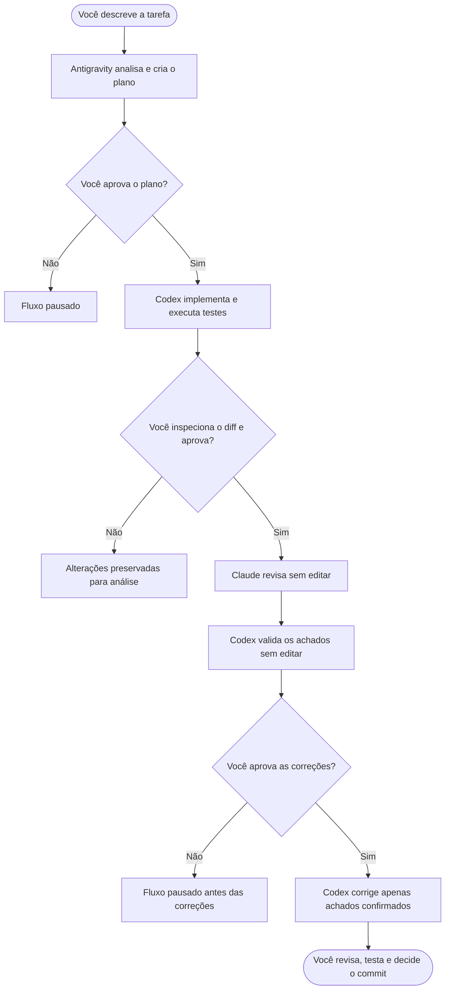

<div align="center">

# AI Orchestrator

### Três agentes de IA, papéis bem definidos e você no controle.

**Antigravity planeja · Codex implementa · Claude revisa · Você aprova**

[](bin/ai-orchestrator)
[](#-pré-requisitos)
[](LICENSE)
[](#-segurança-por-padrão)

[Começar agora](#-início-rápido) · [Entender o fluxo](#-como-funciona) · [Ver exemplo prático](#-exemplo-aplicativo-de-finanças) · [Manual em PDF](docs/manual-pt-BR.pdf)

</div>

---

## 🧩 O problema

Usar vários agentes de programação no mesmo projeto pode acelerar o desenvolvimento, mas também cria riscos:

- dois agentes podem alterar o mesmo arquivo ao mesmo tempo;
- uma implementação pode seguir um plano incorreto;
- o agente que escreveu o código pode deixar de perceber o próprio erro;
- sugestões de revisão podem ser falsos positivos;
- comandos importantes podem ser executados sem uma pausa para avaliação humana;
- fica difícil descobrir quem tomou cada decisão.

O **AI Orchestrator** organiza esse trabalho como uma pequena equipe de desenvolvimento. Cada agente recebe uma responsabilidade específica, somente um deles pode escrever por vez e uma pessoa aprova as transições importantes.

> O objetivo não é remover o desenvolvedor do processo. É permitir que ele use diferentes agentes com mais organização, rastreabilidade e controle.

## 💡 Como isso ajuda no desenvolvimento?

| Sem orquestração | Com AI Orchestrator |
|---|---|
| Agentes podem disputar os mesmos arquivos | Somente o Codex escreve durante as fases autorizadas |
| O mesmo agente implementa e aprova o próprio trabalho | Claude realiza uma revisão independente e sem edição |
| Sugestões da revisão podem virar alterações automaticamente | Codex valida cada achado antes de qualquer correção |
| Decisões ficam espalhadas nas conversas | Cada fase produz um relatório em `.ai-runs/` |
| A automação pode avançar sem supervisão | O fluxo pausa para aprovação humana |
| Interromper pode ser confuso | `ai-orchestrator off` desativa o fluxo e tenta parar a fase ativa |

Benefícios práticos:

- **Planejamento antes do código:** reduz implementações baseadas em premissas erradas.
- **Revisão cruzada:** outro modelo procura bugs, regressões e riscos de segurança.
- **Menos correções desnecessárias:** os achados são verificados antes de serem aplicados.
- **Rastreabilidade:** plano, implementação, revisão, triagem e resultado ficam registrados.
- **Controle de escopo:** os prompts proíbem deploy, `push`, `merge` e mudanças fora do projeto.
- **Aprendizado:** o desenvolvedor consegue acompanhar cada etapa.

## 🔀 Como funciona



### O papel de cada participante

| Participante | Responsabilidade | Permissão principal |
|---|---|---|
| **Antigravity** | Entender o projeto, identificar riscos e produzir o plano | Planejamento em sandbox, sem edição |
| **Codex** | Implementar o plano e executar os testes | Escrita restrita ao workspace |
| **Claude** | Fazer revisão independente e apontar problemas com evidências | Leitura, pesquisa e diagnóstico; sem ferramenta de edição |
| **Codex na triagem** | Verificar se os achados do revisor são verdadeiros | Somente leitura |
| **Você** | Aprovar escopo, mudanças e correções | Decisão final nas etapas críticas |

## 🚀 Início rápido

### 1. Clone e instale

```bash
git clone https://github.com/orleanss777-sys/ai-orchestrator.git
cd ai-orchestrator
install -Dm755 bin/ai-orchestrator "$HOME/.local/bin/ai-orchestrator"
```

Se `$HOME/.local/bin` ainda não estiver no seu `PATH`, execute o arquivo diretamente como `./bin/ai-orchestrator`.

### 2. Confira o ambiente

```bash
ai-orchestrator status
```

O resultado informa se a orquestração está ligada, se existe uma execução ativa e onde os três CLIs foram encontrados.

### 3. Ative a orquestração

```bash
ai-orchestrator on
```

### 4. Entre no projeto que será desenvolvido

```bash
cd ~/projetos/meu-aplicativo
```

### 5. Descreva uma tarefa concreta

```bash
ai-orchestrator run \
  "Adicionar recuperação de senha por e-mail com testes automatizados"
```

O programa começa pelo planejamento e pede que você digite `SIM` antes de avançar pelas fases críticas.

### 6. Desative quando quiser

Em outro terminal:

```bash
ai-orchestrator off
```

Isso impede novas fases e tenta encerrar o processo ativo, preservando os arquivos que já foram produzidos.

## ⌨ Comandos

| Comando | O que faz |
|---|---|
| `ai-orchestrator on` | Permite iniciar e continuar execuções |
| `ai-orchestrator off` | Desativa o fluxo e tenta interromper a fase ativa |
| `ai-orchestrator toggle` | Alterna entre ativado e desativado |
| `ai-orchestrator status` | Mostra o estado, o processo ativo e os CLIs disponíveis |
| `ai-orchestrator run "TAREFA"` | Inicia o fluxo completo para a tarefa informada |
| `ai-orchestrator help` | Exibe a ajuda no terminal |

## 🧪 Exemplo: aplicativo de finanças

Imagine um aplicativo de finanças pessoais que já registra receitas e despesas. A próxima funcionalidade é permitir que o usuário defina um limite mensal para cada categoria.

```bash
cd ~/projetos/minhas-financas
ai-orchestrator on

ai-orchestrator run \
  "Adicionar orçamento mensal por categoria e alertar quando os gastos atingirem 80% e 100% do limite"
```

O fluxo será aproximadamente este:

1. **Antigravity planeja:** identifica telas, banco de dados, regras, migrações, riscos e testes.
2. **Você aprova:** confere se o plano não adiciona integrações bancárias ou recursos fora do pedido.
3. **Codex implementa:** altera o aplicativo, trata valores monetários corretamente e executa os testes.
4. **Você inspeciona:** consulta `git status`, `git diff --stat` e `git diff`.
5. **Claude revisa:** procura arredondamento incorreto, orçamento duplicado, mês errado, validação insuficiente e perda de dados.
6. **Codex faz a triagem:** separa bugs confirmados, achados parcialmente válidos, falsos positivos e itens fora do escopo.
7. **Você aprova as correções:** somente os problemas confirmados são corrigidos.
8. **Codex testa novamente:** gera o relatório final, mas não cria commit nem publica o projeto.

Ao final, a decisão continua sendo sua:

```bash
git status
git diff

# Execute os testes específicos do projeto antes do commit.
```

> Para testar software financeiro, use somente dados fictícios. Não coloque credenciais bancárias, dados pessoais ou informações financeiras reais nos prompts.

## 📄 Relatórios gerados

Cada execução cria uma pasta com data e hora dentro do projeto trabalhado:

```text
.ai-runs/20260901-153000/
├── plano.md                  # Proposta criada pelo Antigravity
├── implementacao.md          # Resumo produzido pelo Codex
├── revisao.md                # Achados do Claude
├── triagem.md                # Validação dos achados pelo Codex
├── resultado-final.md        # Correções e testes finais
└── *.log                     # Saídas técnicas das fases
```

Se esses relatórios não devem ser versionados, acrescente ao `.gitignore` do projeto:

```gitignore
.ai-runs/
```

## 🔒 Segurança por padrão

O executável foi construído com decisões conservadoras:

- planejamento e triagem utilizam modo somente leitura;
- a escrita do Codex fica restrita ao diretório do projeto;
- Claude não recebe a ferramenta `Edit` durante a revisão;
- o usuário precisa digitar `SIM` para avançar;
- o fluxo não executa automaticamente `git commit`, `push`, `merge` ou deploy;
- desligar preserva os artefatos já gerados;
- mudanças locais preexistentes não são apagadas pelo orquestrador.

Essas proteções **reduzem riscos, mas não garantem que o código gerado esteja correto ou seguro**. Leia [SECURITY.md](SECURITY.md), mantenha backups e revise todo comando solicitado pelos agentes.

## 📋 Pré-requisitos

Instale e autentique separadamente:

- [`agy`](https://antigravity.google/docs/cli/install/) — Antigravity CLI;
- [`codex`](https://learn.chatgpt.com/docs/developer-commands?surface=cli) — Codex CLI;
- [`claude`](https://code.claude.com/docs/en/cli-usage) — Claude Code.

O ambiente também precisa de Linux, Bash, Git e `setsid` (normalmente fornecido pelo pacote `util-linux`). O AI Orchestrator não instala, autentica nem compartilha credenciais entre os provedores.

## 🎯 Quando usar

É especialmente útil para:

- funcionalidades que atravessam vários arquivos;
- correções de bugs com causa ainda incerta;
- refatorações que precisam de revisão independente;
- mudanças que exigem testes e critérios de aceite claros;
- projetos em que você quer aprender acompanhando cada fase;
- software financeiro, administrativo ou de dados, onde rastreabilidade importa.

Talvez não seja necessário para corrigir um texto, renomear uma variável ou realizar outra mudança trivial de poucos minutos.

## 🚧 Limitações atuais

- Desenvolvido para Linux com Bash e `setsid`.
- Flags e comportamentos dos CLIs podem mudar entre versões.
- O comando `off` envia um sinal de encerramento, mas não garante a interrupção imediata de processos remotos ou de todos os descendentes.
- O fluxo não substitui revisão profissional, testes, backup, CI/CD ou controles de segurança da organização.
- A qualidade depende do projeto, dos prompts, das versões dos modelos e da avaliação humana.

## 📚 Documentação

- [Manual completo em português](docs/manual-pt-BR.pdf)
- [Política de segurança](SECURITY.md)
- [Como contribuir](CONTRIBUTING.md)

## 🤝 Contribuindo

Sugestões e pull requests são bem-vindos. Antes de contribuir, leia [CONTRIBUTING.md](CONTRIBUTING.md). Mudanças devem preservar os pontos de aprovação humana e os padrões conservadores de permissão.

## 📄 Licença

Distribuído sob a licença [MIT](LICENSE).

## ⚖ Aviso de independência

Este é um projeto comunitário independente. Não possui afiliação, endosso ou patrocínio de Google, OpenAI, Anthropic, Antigravity, Codex ou Claude. Os nomes de produtos e marcas pertencem aos seus respectivos proprietários.

---

<div align="center">

**Gostou da proposta? Dê uma estrela, teste em um projeto não crítico e compartilhe seu feedback.**

</div>

<div align="center">

<sub>Feito com 💙 por [Orleans Samai](https://github.com/orleans-samai)</sub>

</div>
